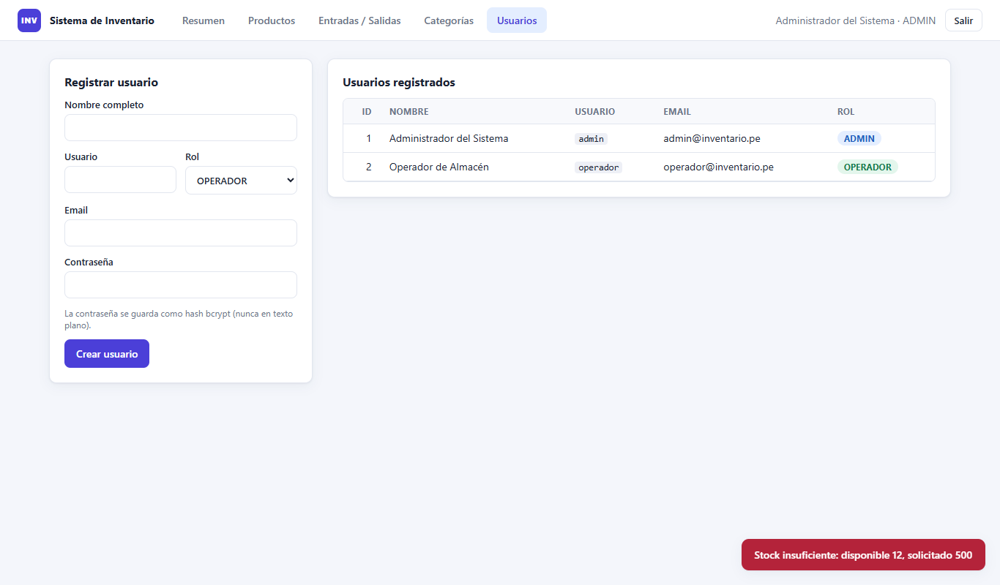
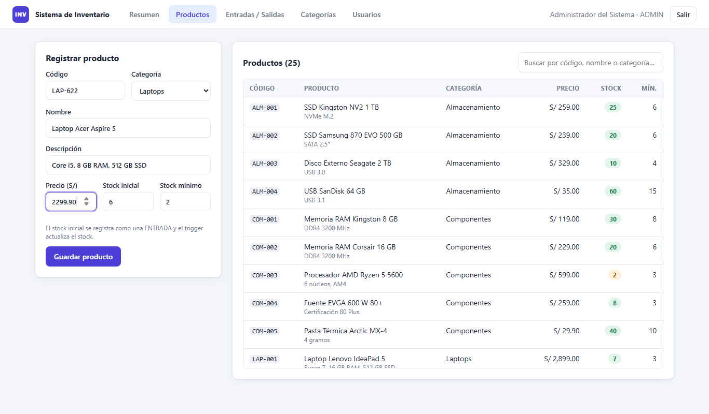
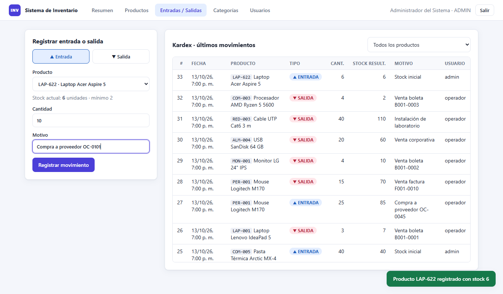
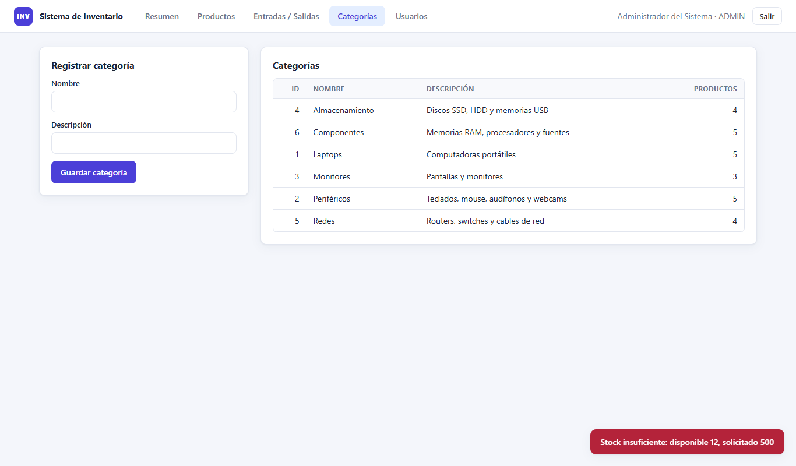

# Sistema de Inventario · Práctica Calificada N.º 2

**Curso:** 100000SI46 – Base de Datos II · **Docente:** Donayre Cáceres, Armando Joel
**Sede:** Ica · **Sección:** 28969 · **Turno:** Noche · **Fecha:** 13/10/2026
**Alumno:** ______________________________

Sistema web de inventario con **usuarios, categorías, productos y movimientos (entradas/salidas)**.
La base de datos **PostgreSQL** está desplegada en **Railway**; el stock se actualiza automáticamente
con un **trigger** y las contraseñas se guardan con **hash bcrypt**.

| Capa | Tecnología |
|---|---|
| Base de datos | PostgreSQL 18 en Railway (extensión `pgcrypto`) |
| Backend | Node.js 20+ · Express 5 · `pg` · `bcryptjs` · `jsonwebtoken` |
| Frontend | HTML + CSS + JavaScript (sin frameworks), servido por Express |

```
├── database/
│   ├── 01_esquema.sql            # Pregunta 1: tablas, PK, FK, CHECK, trigger y vistas
│   ├── 02_datos_prueba.sql       # Pregunta 2: 25 productos, 6 categorías, 2 usuarios, movimientos
│   └── 03_consultas_evidencia.sql
├── src/
│   ├── server.js                 # API Express + manejo de errores de PostgreSQL
│   ├── db.js                     # Pool de conexión (SSL en la nube)
│   ├── middleware/auth.js        # Verificación del token JWT
│   └── routes/
│       ├── auth.js               # Pregunta 3: login y registro de usuarios con bcrypt
│       └── inventario.js         # Pregunta 4: productos, categorías y movimientos
├── public/                       # Pantallas (login y aplicación)
├── scripts/
│   ├── init-db.js                # Ejecuta los scripts SQL en la BD de DATABASE_URL
│   └── capturas.js               # Genera las capturas de evidencia (docs/img)
└── docs/
    ├── modelo-er.mmd             # Fuente del diagrama ER
    └── img/                      # Capturas
```

---

## Pregunta 1 · Modelo relacional (ER + script SQL)


| Tabla | Llave primaria | Llaves foráneas | Restricciones principales |
|---|---|---|---|
| `usuarios` | `id_usuario` | — | `username` y `email` únicos, `rol IN ('ADMIN','OPERADOR')`, `password_hash` (bcrypt) |
| `categorias` | `id_categoria` | — | `nombre` único |
| `productos` | `id_producto` | `id_categoria → categorias` | `codigo` único, `precio >= 0`, `stock >= 0` |
| `movimientos` | `id_movimiento` | `id_producto → productos`, `id_usuario → usuarios` | `tipo IN ('ENTRADA','SALIDA')`, `cantidad > 0` |

**Relaciones (1 a N):**
- Una **categoría** clasifica muchos **productos**.
- Un **producto** tiene muchos **movimientos** (su kardex).
- Un **usuario** registra muchos **movimientos**.

Las FK usan `ON DELETE RESTRICT`: no se puede borrar una categoría con productos ni un producto con
movimientos, así se conserva el historial del inventario.

**Script completo:** [`database/01_esquema.sql`](database/01_esquema.sql). Fragmento de las tablas:

```sql
CREATE TABLE productos (
    id_producto    SERIAL         PRIMARY KEY,
    codigo         VARCHAR(20)    NOT NULL UNIQUE,
    nombre         VARCHAR(120)   NOT NULL,
    id_categoria   INT            NOT NULL,
    precio         NUMERIC(10,2)  NOT NULL CHECK (precio >= 0),
    stock          INT            NOT NULL DEFAULT 0 CHECK (stock >= 0),
    stock_minimo   INT            NOT NULL DEFAULT 5 CHECK (stock_minimo >= 0),
    CONSTRAINT fk_productos_categoria
        FOREIGN KEY (id_categoria) REFERENCES categorias (id_categoria)
        ON UPDATE CASCADE ON DELETE RESTRICT
);

CREATE TABLE movimientos (
    id_movimiento  SERIAL        PRIMARY KEY,
    id_producto    INT           NOT NULL,
    id_usuario     INT           NOT NULL,
    tipo           VARCHAR(10)   NOT NULL CHECK (tipo IN ('ENTRADA', 'SALIDA')),
    cantidad       INT           NOT NULL CHECK (cantidad > 0),
    stock_resultante INT,
    motivo         VARCHAR(255),
    fecha          TIMESTAMPTZ   NOT NULL DEFAULT NOW(),
    CONSTRAINT fk_movimientos_producto FOREIGN KEY (id_producto) REFERENCES productos (id_producto),
    CONSTRAINT fk_movimientos_usuario  FOREIGN KEY (id_usuario)  REFERENCES usuarios (id_usuario)
);
```

---

## Pregunta 2 · Despliegue en la nube (Railway) y datos de prueba

### Pasos realizados

1. **Iniciar sesión** en Railway desde la CLI (abre el navegador para autorizar):
   ```bash
   railway login
   ```
2. **Crear un proyecto nuevo** (separado de otros proyectos de la cuenta) y vincular la carpeta:
   ```bash
   railway init --name INVENTARIO_BD2
   ```
3. **Agregar el servicio PostgreSQL** al proyecto:
   ```bash
   railway add --database postgres
   ```
4. **Habilitar el acceso público (TCP Proxy)** al puerto 5432 del servicio Postgres
   (en el panel: *Postgres → Settings → Networking → TCP Proxy*). Railway asigna un host público
   `*.proxy.rlwy.net:<puerto>`.
5. **Configurar la conexión** en el archivo `.env` (no se sube a GitHub) con la URL pública:
   ```
   DATABASE_URL=postgresql://postgres:<clave>@<host>.proxy.rlwy.net:<puerto>/railway
   ```
6. **Crear las tablas y cargar los datos** en la base de Railway:
   ```bash
   npm run db:init
   ```
   ```
   Conectado a thomas.proxy.rlwy.net:12015/railway (nube)
   ✔ 01_esquema.sql ejecutado (tablas, FKs, trigger y vistas)
   ✔ 02_datos_prueba.sql ejecutado (usuarios, categorías, productos, movimientos)
   ┌───────────────┬───────────┐
   │ tabla         │ registros │
   ├───────────────┼───────────┤
   │ usuarios      │ 2         │
   │ categorias    │ 6         │
   │ productos     │ 25        │
   │ movimientos   │ 32        │
   └───────────────┴───────────┘
   ```

**Datos de prueba** ([`02_datos_prueba.sql`](database/02_datos_prueba.sql)): 6 categorías, **25 productos**,
2 usuarios y 32 movimientos. El stock inicial de cada producto **no se inserta directamente**: se
registra como movimiento `ENTRADA` y el trigger calcula el stock (queda en el kardex).

### Evidencia: consultas ejecutadas sobre la BD de Railway


---

## Pregunta 3 · Inicio de sesión con contraseñas hasheadas

**Flujo:**
1. El usuario envía `username` y `password` a `POST /api/auth/login`.
2. El backend busca el usuario en la BD de Railway (consulta parametrizada, sin inyección SQL).
3. `bcrypt.compare()` aplica el hash a la clave ingresada (con la sal guardada) y lo compara con `password_hash`.
4. Si coincide, se genera un **token JWT** (8 h) que el frontend envía en cada petición; sin token la API responde `401`.
5. Si no coincide, responde siempre *"Usuario o contraseña incorrectos"* (no revela cuál de los dos falló).

**Las contraseñas nunca se guardan en texto plano.** Se almacena un hash **bcrypt** (`$2a$10$…`,
costo 10, con sal aleatoria):
- En los datos de prueba, desde SQL con `pgcrypto`: `crypt('clave', gen_salt('bf', 10))`.
- Al crear usuarios desde la aplicación, en el backend con `bcrypt.hash(password, 10)`.

```js
// src/routes/auth.js
const valido = usuario && usuario.activo && (await bcrypt.compare(password, usuario.password_hash));
if (!valido) return res.status(401).json({ error: 'Usuario o contraseña incorrectos' });
const token = jwt.sign(payload, process.env.JWT_SECRET, { expiresIn: '8h' });
```

| Pantalla de login (conectada a Railway) | Contraseña incorrecta |
|---|---|
|  |  |

Registro de usuarios (solo ADMIN). La contraseña se guarda como hash:



---

## Pregunta 4 · Registro de productos y entradas/salidas con stock automático

El stock se actualiza **automáticamente en la base de datos** con el trigger `trg_movimientos_stock`,
que se ejecuta antes de cada `INSERT` en `movimientos`:

```sql
CREATE OR REPLACE FUNCTION fn_actualizar_stock() RETURNS TRIGGER AS $$
DECLARE v_stock INT;
BEGIN
    SELECT stock INTO v_stock FROM productos
     WHERE id_producto = NEW.id_producto FOR UPDATE;      -- bloquea la fila

    IF NEW.tipo = 'ENTRADA' THEN
        v_stock := v_stock + NEW.cantidad;
    ELSE
        IF v_stock < NEW.cantidad THEN
            RAISE EXCEPTION 'Stock insuficiente: disponible %, solicitado %', v_stock, NEW.cantidad;
        END IF;
        v_stock := v_stock - NEW.cantidad;
    END IF;

    UPDATE productos SET stock = v_stock WHERE id_producto = NEW.id_producto;
    NEW.stock_resultante := v_stock;                      -- queda en el kardex
    RETURN NEW;
END; $$ LANGUAGE plpgsql;

CREATE TRIGGER trg_movimientos_stock
    BEFORE INSERT ON movimientos FOR EACH ROW EXECUTE FUNCTION fn_actualizar_stock();
```

- La aplicación **solo inserta el movimiento**; nunca modifica `productos.stock` directamente.
- Al registrar un producto con stock inicial, el producto y su `ENTRADA` se guardan en **una sola transacción** (`BEGIN … COMMIT`).
- Una salida mayor al stock es **rechazada por el trigger** y el `CHECK (stock >= 0)` sirve de segunda barrera.

**API utilizada por las pantallas**

| Método | Ruta | Descripción |
|---|---|---|
| `POST` | `/api/auth/login` | Inicia sesión |
| `GET/POST` | `/api/productos` | Lista / registra productos |
| `GET/POST` | `/api/movimientos` | Kardex / registra entrada o salida |
| `GET/POST` | `/api/categorias` | Lista / registra categorías |
| `GET` | `/api/resumen` | Indicadores del inventario |

### Capturas del proceso

**1. Resumen del inventario** (indicadores y productos con stock bajo)


**2. Listado de productos**


**3. Registro de un producto nuevo** con stock inicial 6



**4. Entrada de 10 unidades** → el stock pasa de 6 a **16**



**5. Salida de 4 unidades** → el stock pasa de 16 a **12**


**6. Salida de 500 unidades** → el trigger la rechaza por stock insuficiente


**7. Categorías**


---

## Cómo ejecutar

```bash
npm install
```
Copia `.env.example` a `.env` y coloca la `DATABASE_URL` (Railway o local) y un `JWT_SECRET`.

```bash
npm run db:init
```
```bash
npm start
```
Abre <http://localhost:3000>.

**Usuarios de prueba** (definidos en `database/02_datos_prueba.sql`):

| Usuario | Contraseña | Rol |
|---|---|---|
| `admin` | `Admin2026!` | ADMIN |
| `operador` | `Operador2026!` | OPERADOR |
