# Sistema de inventario - Práctica Calificada 2

Base de Datos II · UTP sede Ica · Sección 28969 · Docente: Donayre Cáceres, Armando Joel

Sistema de inventario con usuarios, categorías, productos y movimientos (entradas y salidas).
La base de datos es PostgreSQL y está desplegada en Railway. El stock se actualiza solo con un
trigger y las contraseñas se guardan con hash bcrypt.

- **Sistema en línea:** https://inventario-web-production-89a8.up.railway.app
- **Informe (PDF):** [entrega/Informe_PC2_Base_de_Datos_II.pdf](entrega/Informe_PC2_Base_de_Datos_II.pdf)

Usuarios de prueba: `admin` / `Admin2026!` y `operador` / `Operador2026!`

## Tecnologías

- PostgreSQL 18 en Railway (con la extensión pgcrypto)
- Node.js + Express, `pg`, `bcryptjs` y `jsonwebtoken`
- HTML, CSS y JavaScript para las pantallas

## Estructura

```
database/   scripts SQL (esquema, datos de prueba y consultas)
src/        backend: servidor, conexión y rutas (login, productos, movimientos)
public/     pantallas del sistema
scripts/    crear la BD y cargar datos (init-db.js), generar capturas (capturas.js)
docs/       diagrama ER y capturas
entrega/    informe en PDF
```

## Pregunta 1: modelo relacional

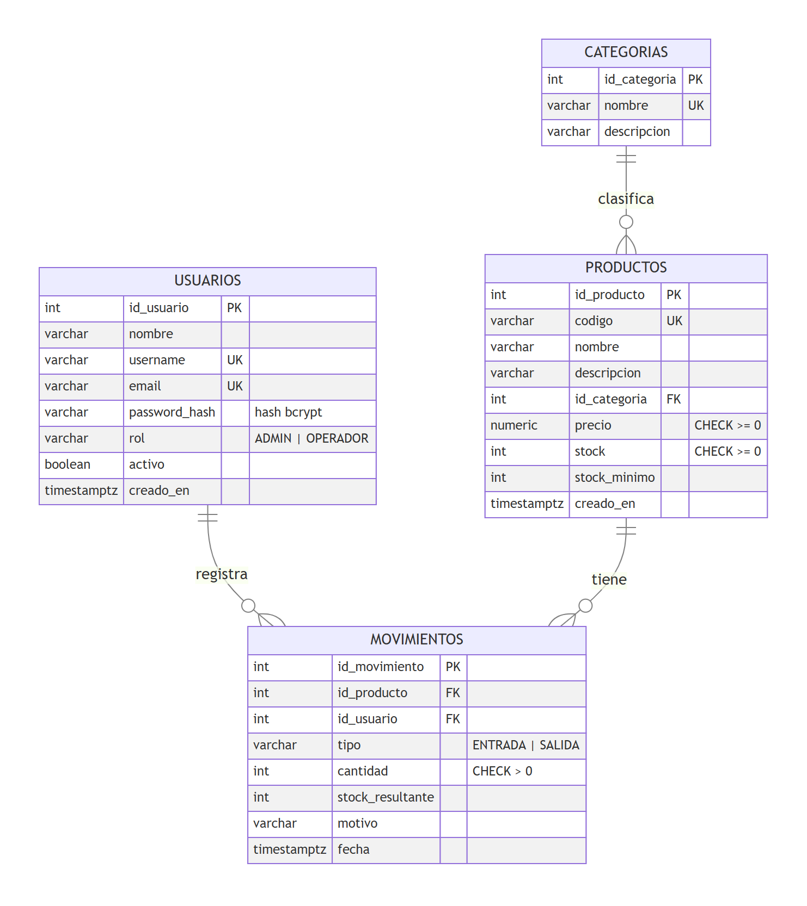

Son cuatro tablas:

- **usuarios**: los que entran al sistema. Se guarda el hash de la contraseña y el rol (ADMIN u OPERADOR).
- **categorias**: para agrupar los productos.
- **productos**: cada uno pertenece a una categoría (FK `id_categoria`).
- **movimientos**: entradas y salidas. Tiene FK al producto y al usuario que lo registró.

También hay restricciones `CHECK` (precio y stock no negativos, cantidad mayor a 0, tipo ENTRADA o SALIDA)
y las FK tienen `ON DELETE RESTRICT` para no perder el historial. El script está en
[database/01_esquema.sql](database/01_esquema.sql).

## Pregunta 2: base de datos en Railway

Pasos que seguí:

```bash
railway login
railway init --name INVENTARIO_BD2
railway add --database postgres
```

Después activé el TCP Proxy del servicio Postgres para conectarme desde mi PC, puse la cadena de
conexión en el `.env` (no se sube al repo) y cargué todo con:

```bash
npm run db:init
```

Quedan 6 categorías, 25 productos, 2 usuarios y 32 movimientos. El stock inicial de cada producto entra
como un movimiento de ENTRADA, así lo calcula el trigger.

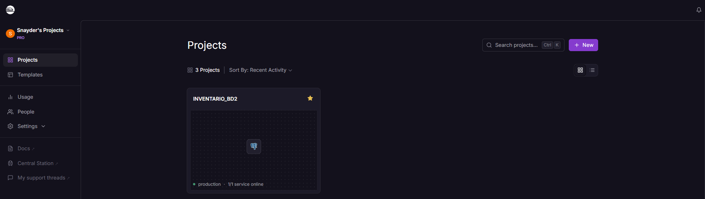
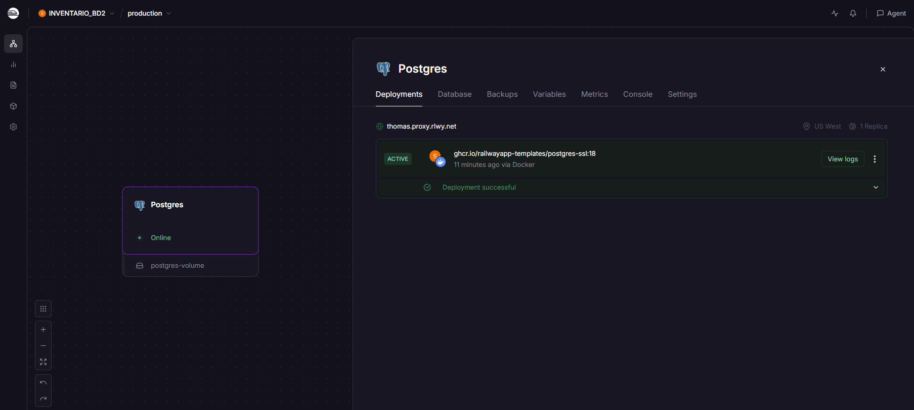
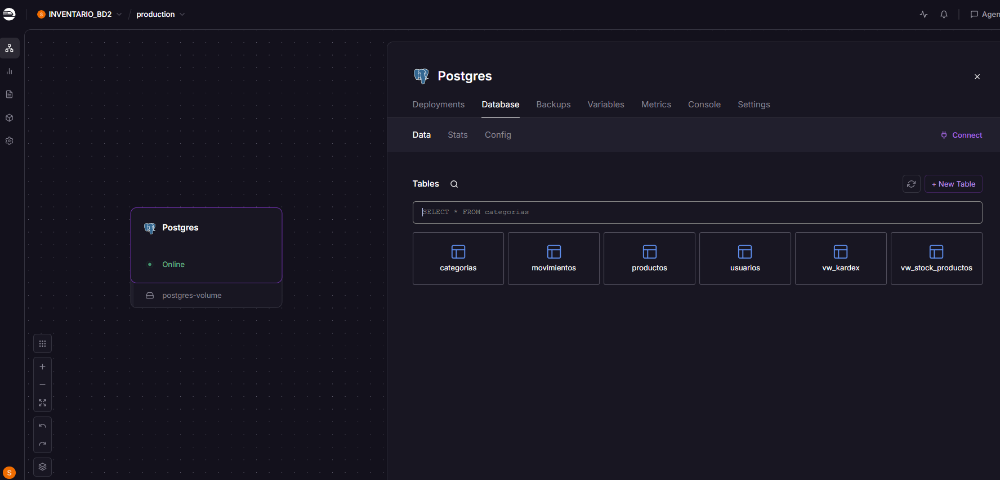
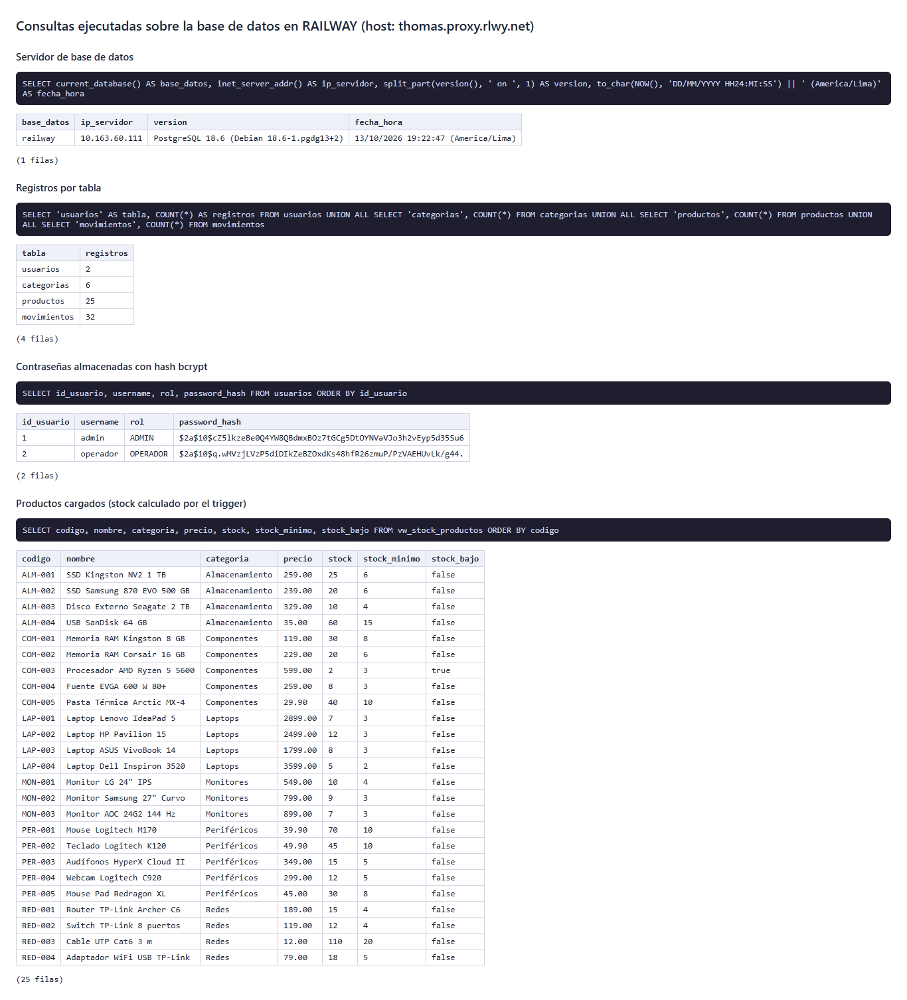

## Pregunta 3: inicio de sesión

El login (`POST /api/auth/login`) busca al usuario en la BD de Railway y compara la contraseña con
`bcrypt.compare()`. Si está bien devuelve un token JWT (8 horas) que el frontend manda en cada petición.
Sin token la API responde 401.

En la tabla solo se guarda el hash (`$2a$10$...`). Los usuarios de prueba se crearon con
`crypt('clave', gen_salt('bf', 10))` y los que se crean desde el sistema con `bcrypt.hash()`.

| Login | Contraseña incorrecta |
|---|---|
| 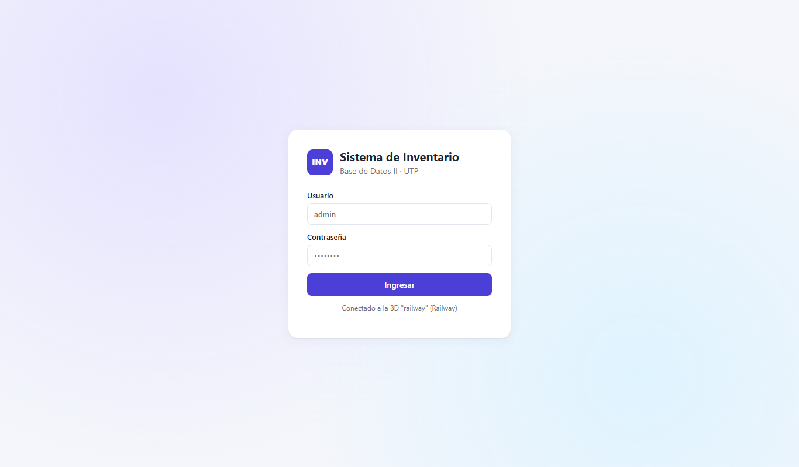 | 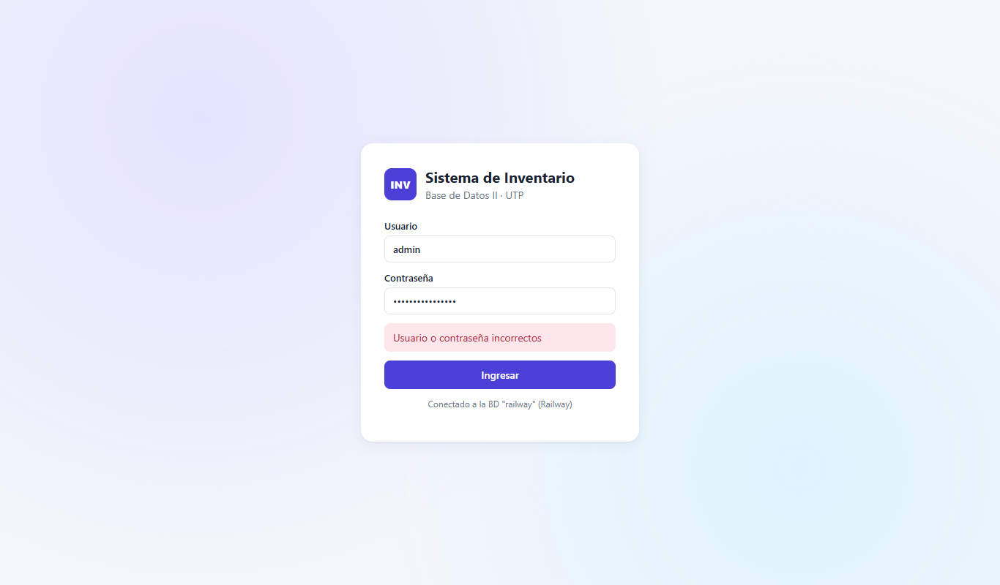 |

## Pregunta 4: productos, entradas y salidas

El stock lo actualiza el trigger `trg_movimientos_stock` antes de cada `INSERT` en `movimientos`:
suma si es entrada, resta si es salida y lanza un error si no alcanza el stock. El backend solo
inserta el movimiento, nunca toca el stock directamente.

| | |
|---|---|
| 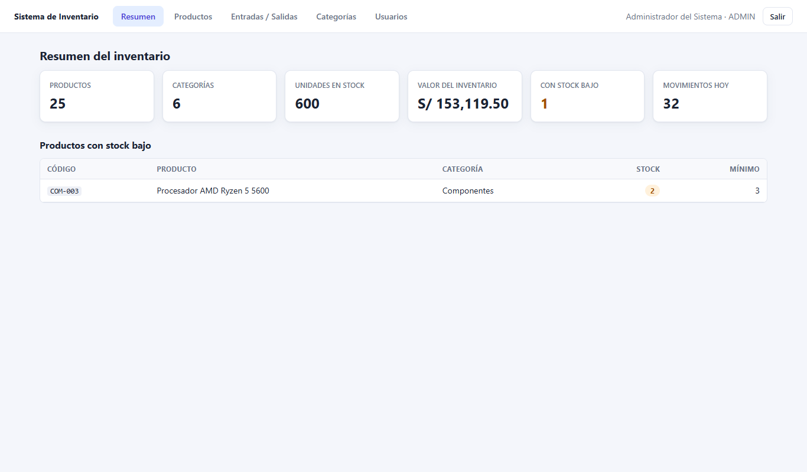 | 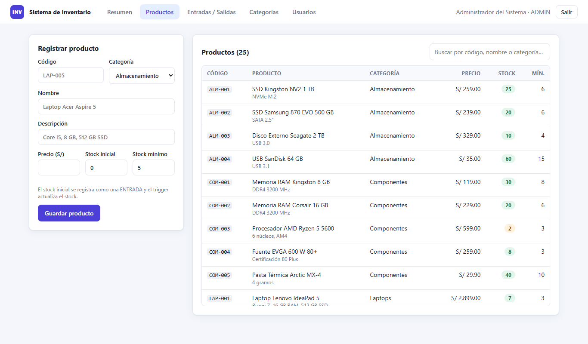 |
| Registro de producto con stock inicial 6 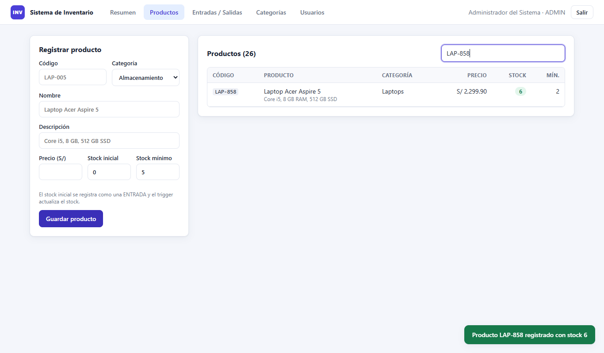 | Entrada de 10 → stock 16 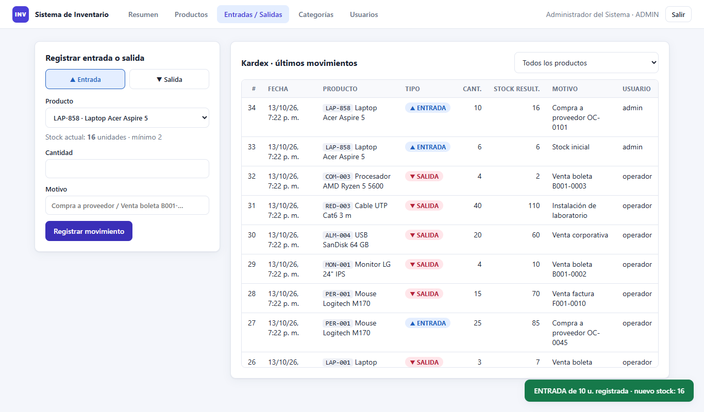 |
| Salida de 4 → stock 12 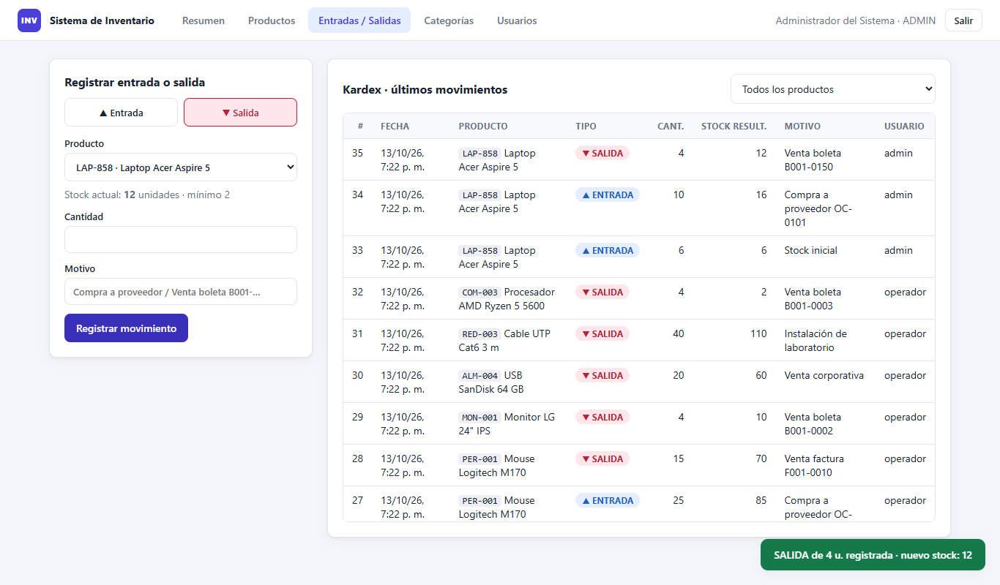 | Salida de 500 rechazada 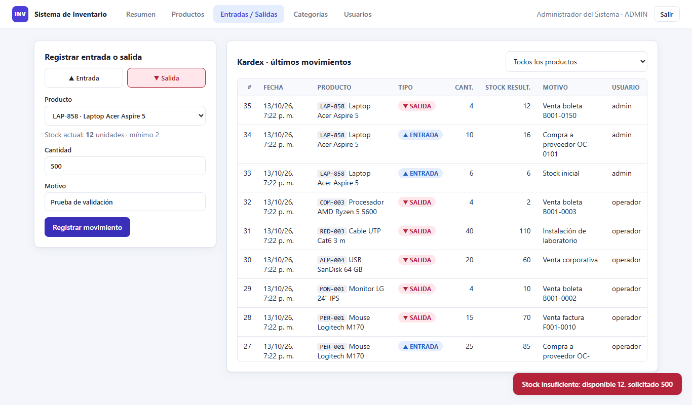 |

## Cómo ejecutarlo en local

```bash
npm install
```

Copiar `.env.example` como `.env` y poner la `DATABASE_URL` y un `JWT_SECRET`. Luego:

```bash
npm run db:init
```

```bash
npm start
```

Y abrir http://localhost:3000
